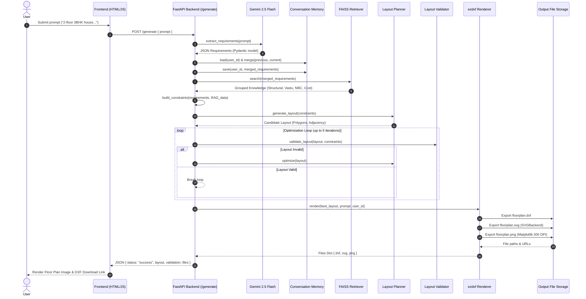

# Nesto AI Smart House Planning System
## Production-Grade Technical Architecture & Engineering Report

---

## 1. Project Overview

### 1.1 Purpose of Nesto
**Nesto** is an intelligent, AI-powered spatial architecture and floor plan generation system designed to transform natural language user descriptions into fully validated, structural-grade CAD blueprints. Nesto bridges the gap between creative user intent (e.g., *"Create a modern 2-floor house with 3 bedrooms, open kitchen, Vastu compliance, and RCC frame"*) and technical architectural blueprints ready for drafting and construction.

### 1.2 Problem Statement
Traditional house planning and architectural design suffer from critical friction points:
- **High Cost & Delay**: Initial schematic designs and feasibility checks require manual iterations by architects over days or weeks.
- **Rule & Code Complexity**: Homeowners and designers struggle to manually synthesize overlapping constraints, including NBC (National Building Code), local municipal zoning setback laws, structural framing logic, and cultural/architectural guidelines (such as Vastu Shastra).
- **Format Disconnect**: Conceptual generative AI tools produce static non-vector images (JPEGs/PNGs) that lack accurate scale, CAD vector entities, wall thickness, or export compatibility with professional CAD tools (`.dxf`).

Nesto solves these problems by providing an automated, RAG-grounded, multi-stage layout generation and CAD rendering engine that creates valid, dimensioned architectural spatial layouts in DXF, SVG, and PNG formats in seconds.

### 1.3 AI-Powered Architecture & Grounding
Nesto pairs **Large Language Models (LLM)** with a specialized **Retrieval-Augmented Generation (RAG)** pipeline:
1. **LLM Structured Requirement Extraction**: Uses Google Gemini (`gemini-2.5-flash`) with structured JSON schema outputs to parse natural language prompts into typed Pydantic requirement schemas (`Requirements`, `RoomRequirements`, `PlotRequirements`, `Preferences`).
2. **Knowledge Base Grounding (RAG)**: Integrates vector search (FAISS + Google `text-embedding-004`) across domain-specific data corpora spanning NBC building codes, room dimensional standards, structural engineering guidelines, material specifications, and Vastu rules.
3. **Constraint Fusion & Layout Generation**: Merges spatial user requirements with retrieved architectural constraints, generating candidate polygon coordinates, wall vectors, and adjacency graphs.
4. **Validation & Optimization Loop**: Applies automated rule checking (area bounds, missing rooms, structural alignment, cross-ventilation, Vastu compliance) across up to 5 optimization iterations before rendering.

---

## 2. System Architecture

```
                      +-----------------------------+
                      |         User Input          |
                      | (Natural Language Prompt)   |
                      +-----------------------------+
                                     |
                                     v
                      +-----------------------------+
                      |       FastAPI Backend       |
                      |     (REST Router Endpoint)  |
                      +-----------------------------+
                                     |
                                     v
                      +-----------------------------+
                      |  LLM Requirement Extractor  |
                      |  (Gemini + Pydantic Schema) |
                      +-----------------------------+
                                     |
                                     v
                      +-----------------------------+
                      |     Constraint Processing   |
                      |   (State Fusion & Normalizer|
                      +-----------------------------+
                                     |
                                     v
                      +-----------------------------+
                      |    RAG Retrieval System     |
                      |  (FAISS + text-embedding)   |
                      +-----------------------------+
                                     |
                                     v
+--------------------------------------------------------------------------+
|                              Knowledge Base                              |
| (Building Codes | Vastu Rules | Room Standards | Structural | Cost Data)|
+--------------------------------------------------------------------------+
                                     |
                                     v
                      +-----------------------------+
                      |        Layout Planner       |
                      | (Spatial Geometry Generator)|
                      +-----------------------------+
                                     |
                                     v
                      +-----------------------------+
                      |      Validation Engine      |
                      | (5x Iterative Optimizer)    |
                      +-----------------------------+
                                     |
                                     v
                      +-----------------------------+
                      |         CAD Renderer        |
                      | (Polygons->Walls/Doors/Furniture)
                      +-----------------------------+
                                     |
                                     v
                      +-----------------------------+
                      |    DXF / SVG / PNG Export   |
                      |     (ezdxf + Matplotlib)    |
                      +-----------------------------+
                                     |
                                     v
                      +-----------------------------+
                      |    Frontend Visualization   |
                      |   (HTML5 / Tailwind UI)     |
                      +-----------------------------+
```

### Component Breakdown

| Component | Class / File Path | Key Responsibility |
| :--- | :--- | :--- |
| **FastAPI Backend** | [`backend/main.py`](file:///c:/Users/prajw/OneDrive/Documents/nesto/backend/main.py) | Application entrypoint, mounts `/static` and `/output` directories, registers authentication (`auth_router`) and generation (`generate_router`) endpoints. |
| **LLM Extractor** | [`backend/api/rag/extractor.py`](file:///c:/Users/prajw/OneDrive/Documents/nesto/backend/api/rag/extractor.py) | Invokes Gemini 2.5 Flash via [`llm_parser.py`](file:///c:/Users/prajw/OneDrive/Documents/nesto/backend/api/rag/extractor_1/llm_parser.py), enforces JSON schemas, normalizes and validates requirements into Python Pydantic structures. |
| **State Merger & Memory** | [`backend/memory/conversation.py`](file:///c:/Users/prajw/OneDrive/Documents/nesto/backend/memory/conversation.py) | Persists user session history and merges multi-turn user prompt adjustments with existing spatial requirements. |
| **Vector Retriever** | [`backend/api/rag/retriever.py`](file:///c:/Users/prajw/OneDrive/Documents/nesto/backend/api/rag/retriever.py) | Converts requirements into vector queries, performs L2-normalized FAISS similarity search, and categorizes retrieved chunks into structural, Vastu, planning, and cost contexts. |
| **Constraint Builder** | [`backend/api/rag/constraints.py`](file:///c:/Users/prajw/OneDrive/Documents/nesto/backend/api/rag/constraints.py) | Fuses RAG metadata with user specifications to build consolidated multi-domain spatial, structural, and environmental constraints. |
| **Layout Planner** | [`backend/api/rag/planner.py`](file:///c:/Users/prajw/OneDrive/Documents/nesto/backend/api/rag/planner.py) | Maps target plot dimensions and room specifications into precise 2D spatial coordinate polygons, bounding boxes, area calculations, and topological adjacency graphs. |
| **Optimizer & Validator** | [`backend/api/rag/layout_validator.py`](file:///c:/Users/prajw/OneDrive/Documents/nesto/backend/api/rag/layout_validator.py) | Evaluates candidate floor plans for missing rooms, boundary collisions, cross-ventilation, structural integrity, and Vastu directional orientations; executes up to 5 optimization iterations. |
| **CAD Renderer & Exporter** | [`backend/api/rag/renderer/renderer.py`](file:///c:/Users/prajw/OneDrive/Documents/nesto/backend/api/rag/renderer/renderer.py) | Converts polygon geometry into standard CAD layer entities (walls, doors, windows, furniture, labels, hatches), exporting native DXF, SVG, and rasterized PNG artifacts via [`exporter.py`](file:///c:/Users/prajw/OneDrive/Documents/nesto/backend/api/rag/renderer/exporter.py). |

---

## 3. Technology Stack

### 3.1 Frontend
- **HTML5**: Semantic web UI templates using Jinja2 engine rendering.
- **Tailwind CSS**: Modern utility-first responsive layout framework configured via CDN for glassmorphism panels, responsive sidebars, and control forms.
- **JavaScript (Vanilla ES6+)**: Dynamic fetch request handlers, AJAX asynchronous chat stream updates, dynamic image rendering, and DOM manipulation.

### 3.2 Backend
- **FastAPI (v0.100+)**: Asynchronous, ultra-high performance Python Web Framework with automatic OpenAPI schema generation.
- **Python (v3.10+)**: Core language environment leveraging typing, Pydantic data validation, dynamic math geometry utilities, and CAD bindings.
- **SQLAlchemy (v2.0+)**: Object-Relational Mapper (ORM) powering declarative models, session dependency injection (`get_db`), and transactions.
- **PostgreSQL / SQLite**: Relational database storage for system users, subscription plans, hashed credentials, and metadata timestamps.

### 3.3 Artificial Intelligence & RAG
- **LLM Integration**: Google GenAI SDK running `gemini-2.5-flash` with zero-temperature JSON mode enforcement for deterministic schema extraction.
- **Embedding Engine**: Google GenAI `text-embedding-004` (3072-dimensional embeddings) with local SHA-256 fallback generators for offline testing resilience.
- **Vector Database**: **FAISS (Facebook AI Similarity Search)** with L2 distance normalization and pickle-backed metadata indexing ([`faiss.index`](file:///c:/Users/prajw/OneDrive/Documents/nesto/backend/data/embeddings/index/faiss.index), [`faiss_metadata.pkl`](file:///c:/Users/prajw/OneDrive/Documents/nesto/backend/data/embeddings/index/faiss_metadata.pkl)).

### 3.4 CAD & Graphics Rendering Pipeline
- **ezdxf**: AutoCAD DXF generator (DXF AC1024 / R2010 format) managing drawing modelspace, custom layers, blocks, and geometric primitives.
- **ezdxf.addons.drawing SVGBackend**: Vector graphics exporter producing SVG documents formatted to standard A4 (210mm x 297mm) aspect ratios.
- **MatplotlibBackend & Pyplot**: High-DPI (300 DPI) raster graphics renderer converting CAD entity collections into web-displayable PNG floor plans.

---

## 4. Folder Structure & Subsystem Responsibilities

```
nesto/
├── backend/
│   ├── main.py                     # FastAPI app setup, static mounting, router inclusion
│   ├── api/
│   │   ├── auth.py                 # Login, register, logout, profile update endpoints
│   │   ├── generate.py             # Floor plan generation router (/generate)
│   │   ├── history.py              # User generation history routes
│   │   ├── save.py                 # Save blueprint functionality
│   │   ├── export.py               # Blueprint export dispatcher
│   │   ├── 2d/                     # 2D rendering helper modules
│   │   ├── 3d/                     # 3D spatial projection stubs
│   │   └── rag/                    # Core AI, RAG & CAD layout processing engine
│   │       ├── pipeline.py         # Master workflow orchestrator (generate function)
│   │       ├── extractor.py        # LLM extractor entrypoint
│   │       ├── extractor_1/        # LLM prompt templates, schemas, parser & normalizer
│   │       │   ├── schema.py       # Pydantic requirements model definitions
│   │       │   ├── prompt.py       # Structured Gemini system prompt builder
│   │       │   ├── llm_parser.py   # Gemini API client call & JSON parsing
│   │       │   ├── normalizer.py   # Unit conversions & default value infills
│   │       │   └── validator.py    # Requirement sanity checker
│   │       ├── indexing/           # Vector index builder and chunker scripts
│   │       │   ├── loader.py       # Knowledge base text loader
│   │       │   ├── chunker.py      # Fixed-size overlapping text chunker
│   │       │   ├── embedder.py     # Gemini embedding API integration
│   │       │   └── builder.py      # FAISS index builder script
│   │       ├── retriever.py        # FAISS vector similarity search engine
│   │       ├── constraints.py      # RAG & user requirements fusion engine
│   │       ├── constraint_fusion.py# Merges conflicting domain constraints
│   │       ├── planner.py          # Spatial room coordinate & adjacency graph generator
│   │       ├── optimizer.py        # Iterative layout coordinate tuner
│   │       ├── layout_validator.py # Spatial rule, NBC code & Vastu validator
│   │       ├── renderer.py         # Main renderer facade
│   │       └── renderer/           # Complete ezdxf rendering system
│   │           ├── renderer.py     # Wall/door/window/furniture draw orchestrator
│   │           ├── exporter.py     # DXF, SVG, PNG file exporter
│   │           ├── wall_generator.py # Extrudes room boundaries into wall lines
│   │           ├── door_generator.py # Inserts door openings & swing arcs
│   │           ├── window_generator.py # Inserts wall window symbols
│   │           ├── furniture.py    # Draws room-specific furniture blocks
│   │           ├── labels.py       # Computes centroids & attaches room names/areas
│   │           ├── hatch.py        # Applies flooring hatch patterns
│   │           ├── dimensions.py   # Adds dimension lines & ticks
│   │           └── symbols.py      # CAD symbol library definitions
│   ├── data/                       # Architecture knowledge base datasets
│   │   ├── architecture/           # Architectural design guidelines
│   │   ├── building_codes/         # NBC regulations & setback limits
│   │   ├── cost/                   # Material & construction cost indices
│   │   ├── datasets/               # Raw text training data
│   │   ├── embeddings/             # FAISS index files (.index & .pkl)
│   │   ├── engineering/            # MEP & drainage guidelines
│   │   ├── furniture/              # Standard dimension catalogs
│   │   ├── materials/              # Concrete, brick & steel standards
│   │   ├── optimization/           # Space efficiency rules
│   │   ├── planning_rules/         # Setback, height & FAR regulations
│   │   ├── structural/             # Beam spacing & column grid specifications
│   │   ├── templates/              # Standard room layout templates
│   │   └── vastu/                  # Vastu orientation & directional guidelines
│   ├── db/
│   │   └── models.py               # SQLAlchemy ORM models (User) & database setup
│   └── memory/
│       └── conversation.py         # Session state persistence & requirements history
├── frontend/                       # HTML5 Jinja templates
│   ├── index.html                  # Main project workspace & chat interface
│   ├── login.html                  # User login view
│   ├── register.html               # User registration view
│   ├── profile.html                # User profile management view
│   └── subscription.html           # Plan selection view
├── output/                         # Generated DXF, SVG, PNG & JSON artifacts
├── static/                         # Uploaded user avatars & frontend assets
└── docs/                           # Technical documentation sub-pages
```

---

## 5. AI & RAG Pipeline Deep-Dive

### 5.1 Step-by-Step Prompt Processing Pipeline

```
"Create a modern 2-floor house with 3 bedrooms..."
                          │
                          ▼
             [LLM Requirement Extractor]
     - Prompt Template: extractor_1/prompt.py
     - Gemini 2.5 Flash API (temp=0, mime=json)
                          │
                          ▼
                  Requirements JSON
    { building_type: "villa", floors: 2, rooms: { bedrooms: 3... } }
                          │
                          ▼
             [Normalizer & Validator]
     - Standardizes units (meters to mm)
     - Applies domain defaults
                          │
                          ▼
            [FAISS Vector Retriever]
     - Query constructed from Requirements
     - Embeddings generated via text-embedding-004
     - FAISS Index L2 Similarity Search (top_k=8)
     - Grouped into structural, vastu, planning, cost
                          │
                          ▼
             [Constraint Builder]
     - Merges user requirements + retrieved knowledge
     - Outputs consolidated constraints object
                          │
                          ▼
             [Layout Planner Engine]
     - Plots plot boundary (width x height)
     - Places room polygons (Living, Bedrooms, Kitchen, Baths)
     - Generates topological adjacency graph
                          │
                          ▼
         [Optimization & Validation Loop]
     - Runs up to 5 iterations of spatial optimization
     - Validates room counts, total areas, Vastu, framing
                          │
                          ▼
                [CAD Renderer Engine]
     - ezdxf modelspace generation
     - Exports DXF, SVG, and high-res PNG outputs
```

### 5.2 Vector Search & Knowledge Grounding Detail
1. **Index Generation**: Knowledge documents in `backend/data/` are chunked using [`chunker.py`](file:///c:/Users/prajw/OneDrive/Documents/nesto/backend/api/rag/indexing/chunker.py) (500-character chunks with 50-character overlap) and embedded with Google `text-embedding-004`. The vectors are stored in a FAISS Flat L2 index (`faiss.index`).
2. **Retrieval**: During a user request, [`retriever.py`](file:///c:/Users/prajw/OneDrive/Documents/nesto/backend/api/rag/retriever.py) constructs a contextual query from the extracted `Requirements` object, embeds it, normalizes the query vector (`faiss.normalize_L2`), and performs an L2 search across the index.
3. **Categorization**: Retrieved text snippets are classified via filename origin into `room_standards`, `planning_rules`, `structural`, `vastu`, `cost`, `architecture`, and `engineering` buckets.

---

## 6. Complete API Reference

### 6.1 `POST /generate`
- **Description**: Generates a floor plan layout and corresponding CAD files from a natural language prompt.
- **Input Schema** (`application/json`):
  ```json
  {
    "prompt": "Create a modern 2-floor house with 3 bedrooms, 2 bathrooms, open kitchen, and east entrance."
  }
  ```
- **Output Schema** (`application/json`):
  ```json
  {
    "status": "success",
    "prompt": "Create a modern 2-floor house with 3 bedrooms, 2 bathrooms, open kitchen, and east entrance.",
    "layout": {
      "plot": { "width": 12000, "height": 18000 },
      "rooms": [
        {
          "id": "living_room_500_500",
          "type": "living_room",
          "x": 500, "y": 500,
          "width": 5000, "height": 4500,
          "area": 22500000,
          "polygon": [[500, 500], [5500, 500], [5500, 5000], [500, 5000]]
        }
      ],
      "adjacency_graph": [
        { "from": "living_room", "to": "kitchen" }
      ],
      "total_area": 145000000
    },
    "validation": {
      "valid": true,
      "score": 100,
      "errors": [],
      "warnings": []
    },
    "files": {
      "dxf": "output/floorplan_1.dxf",
      "svg": "output/floorplan_1.svg",
      "png": "output/floorplan_1.png",
      "dxf_url": "/output/floorplan_1.dxf",
      "svg_url": "/output/floorplan_1.svg",
      "png_url": "/output/floorplan_1.png"
    },
    "summary": {
      "rooms": 10,
      "valid": true
    }
  }
  ```

### 6.2 `POST /register`
- **Description**: Registers a new user with email and hashed password.
- **Content-Type**: `application/x-www-form-urlencoded`
- **Parameters**: `name`, `email`, `password`, `confirm_password`, `role`, `terms`
- **Response**: Redirect (`302`) to `/login`.

### 6.3 `POST /login`
- **Description**: Authenticates user against stored Bcrypt password hash.
- **Content-Type**: `application/x-www-form-urlencoded`
- **Parameters**: `email`, `password`
- **Response**: Redirect (`302`) to `/profile`.

### 6.4 `POST /profile/update`
- **Description**: Updates user profile information and optional avatar file upload.
- **Content-Type**: `multipart/form-data`
- **Parameters**: `name`, `email`, `phone_number`, `age`, `role`, `profile_image` (file)
- **Response**: Redirect (`303`) to `/`.

---

## 7. Data Flow Sequence Diagram



---

## 8. Database Architecture & Authentication Flow

### 8.1 Database Schema Definition
Nesto uses SQLAlchemy ORM mapping to PostgreSQL / SQLite.

```
+----------------------------------------------------------------+
|                             USERS                              |
+-------------------+-------------------+------------------------+
| Column            | Type              | Constraints            |
+-------------------+-------------------+------------------------+
| user_id           | INTEGER           | PK, Auto-Increment     |
| name              | VARCHAR(100)      | NOT NULL               |
| email             | VARCHAR(255)      | UNIQUE, NOT NULL       |
| password_hash     | VARCHAR(255)      | NOT NULL               |
| phone_number      | VARCHAR(15)       | UNIQUE, NULLABLE       |
| age               | INTEGER           | NULLABLE               |
| role              | VARCHAR(50)       | DEFAULT 'User'         |
| image_url         | TEXT              | NULLABLE               |
| subscription_plan | VARCHAR(20)       | DEFAULT 'FREE'         |
| created_at        | TIMESTAMP         | DEFAULT NOW()          |
| updated_at        | TIMESTAMP         | DEFAULT NOW()          |
+-------------------+-------------------+------------------------+
```

### 8.2 Authentication Security Workflow
1. **Password Hashing**: Uses `passlib.context.CryptContext` with `bcrypt` scheme. Passwords are never stored in plaintext.
2. **Verification**: During `POST /login`, `pwd_context.verify(password, user.password_hash)` evaluates credential validity.
3. **DB Dependency Injection**: Managed via standard FastAPI dependency `db: Session = Depends(get_db)`, ensuring connection cleanup per request.

---

## 9. CAD & Graphics Rendering Pipeline

The rendering system in [`backend/api/rag/renderer/renderer.py`](file:///c:/Users/prajw/OneDrive/Documents/nesto/backend/api/rag/renderer/renderer.py) transforms spatial JSON definitions into complete CAD drawings:

```
Spatial JSON Layout
       │
       ▼
[1. Polygon Normalization] ──► Converts coordinate points into Point(x,y) & Line(start, end)
       │
       ▼
[2. Wall Generation]       ──► WallGenerator extrudes perimeter lines into double-line wall structures
       │
       ▼
[3. Door Placement]        ──► DoorGenerator cuts wall segments & adds door swing arcs (900mm width)
       │
       ▼
[4. Window Placement]      ──► WindowGenerator inserts multi-line window symbols (1200mm width)
       │
       ▼
[5. Furniture Layout]      ──► FurnitureGenerator places beds, sofas, tables according to room type
       │
       ▼
[6. Annotation & Hatching] ──► LabelGenerator attaches text labels; HatchGenerator applies floor hatching
       │
       ▼
[7. Exporter Engine]       ──► Produces Native DXF, A4 SVG, and 300 DPI Matplotlib PNG outputs
```

---

## 10. Installation & Setup Guide

### 10.1 System Requirements
- Python 3.10+
- PostgreSQL 14+ (or SQLite for local development)
- C++ Build Tools (required for `faiss-cpu` installation on Windows)

### 10.2 Environment Configuration
Create a `.env` file in the root directory:
```env
DATABASE_URL=sqlite:///./nesto.db
GEMINI_API_KEY=your_gemini_api_key_here
GOOGLE_API_KEY=your_google_api_key_here
```

### 10.3 Quickstart Commands
```bash
# 1. Clone repository & navigate to workspace
git clone https://github.com/Prajwal7896/nesto.git
cd nesto

# 2. Set up virtual environment
python -m venv venv
venv\Scripts\activate     # On Windows
# source venv/bin/activate # On Linux/macOS

# 3. Install dependencies
pip install -r requirements.txt

# 4. Initialize Database & Run Server
python -m uvicorn backend.main:app --reload --host 0.0.0.0 --port 8000
```
Access the application at `http://localhost:8000`.

---

## 11. Development Extension Guide

### 11.1 Adding a New Room Type
1. Update `ROOM_MAP` in [`backend/api/rag/layout_validator.py`](file:///c:/Users/prajw/OneDrive/Documents/nesto/backend/api/rag/layout_validator.py).
2. Add room dimensions in [`backend/api/rag/planner.py`](file:///c:/Users/prajw/OneDrive/Documents/nesto/backend/api/rag/planner.py) inside `create_rooms()`.
3. Add furniture symbols for the room type in [`backend/api/rag/renderer/furniture.py`](file:///c:/Users/prajw/OneDrive/Documents/nesto/backend/api/rag/renderer/furniture.py).

### 11.2 Adding a New Architectural Rule
1. Add markdown rule text under `backend/data/planning_rules/` or `backend/data/vastu/`.
2. Run the FAISS index rebuild script (`python backend/api/rag/indexing/builder.py`).
3. Update constraint evaluation methods in [`backend/api/rag/constraints.py`](file:///c:/Users/prajw/OneDrive/Documents/nesto/backend/api/rag/constraints.py).

---

## 12. Future Architectural Improvements

1. **Computer Vision Spatial Validation**: Integrate YOLOv8 or OpenCV post-rendering checks to detect wall overlaps, door collisions, or unclipped lines visually.
2. **BIM Integration (IFC Export)**: Extend `ezdxf` pipeline to export Industry Foundation Classes (`.ifc`) files for 3D Revit and ArchiCAD interoperability.
3. **Agentic Multi-Agent Architecture**: Transition the single pipeline into specialized AI agents (e.g., *Architect Agent*, *Structural Engineering Agent*, *Vastu Specialist Agent*, *Cost Estimation Agent*) conversing over an agentic mesh.
4. **Real-Time Collaboration**: WebSocket integration for multi-user real-time floorplan editing and dynamic constraint re-solving.

---
*Report compiled for Nesto AI Smart House Planning System.*
